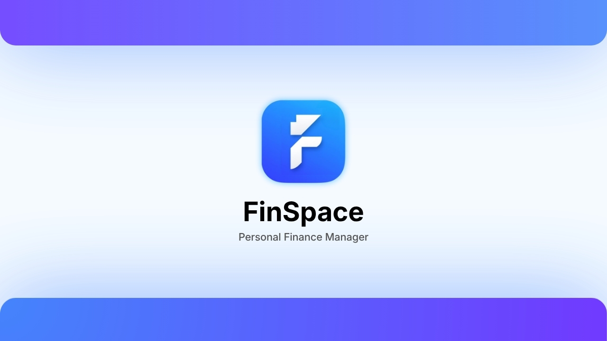
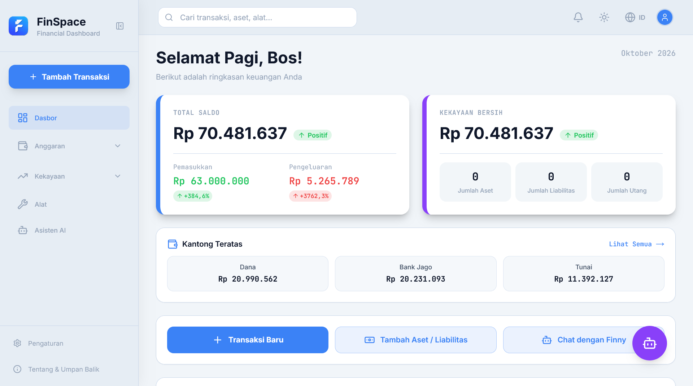
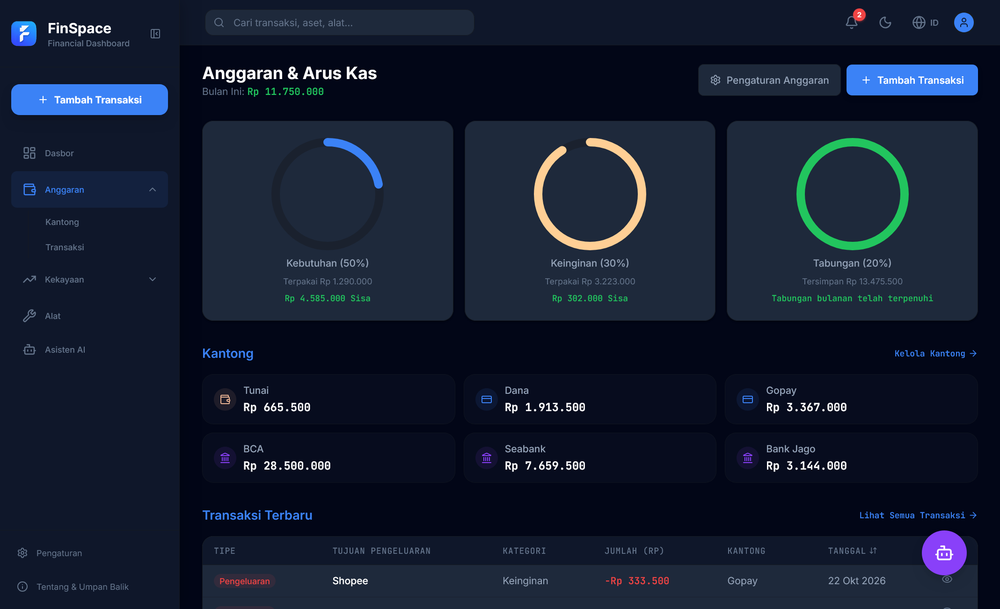
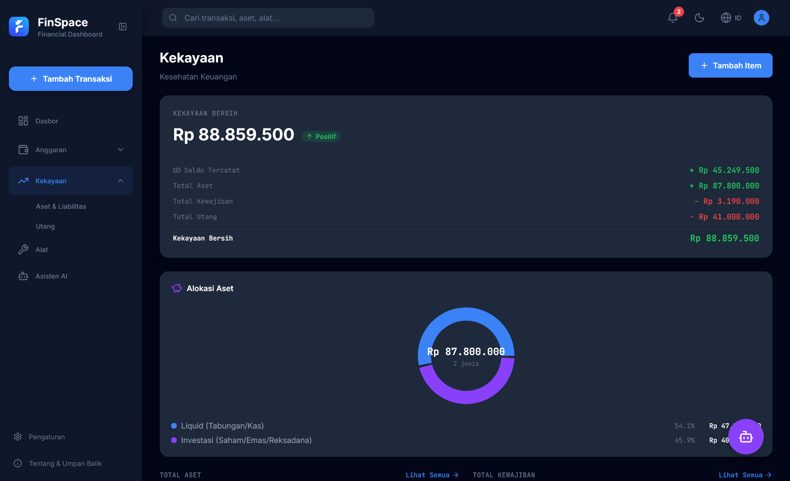
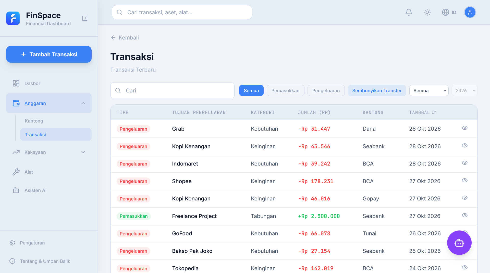
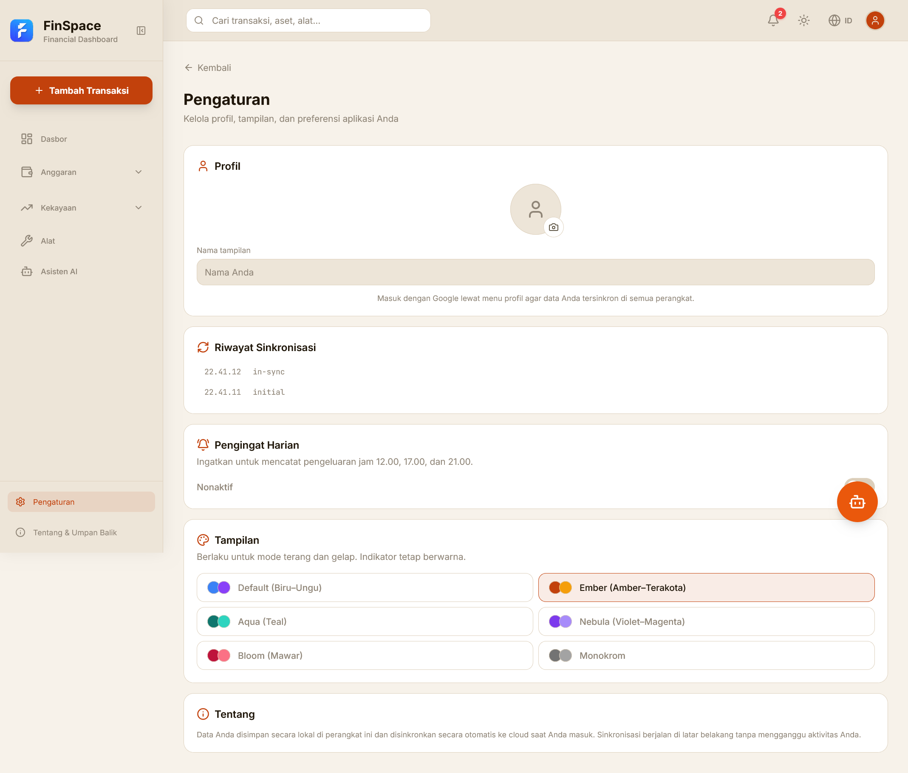
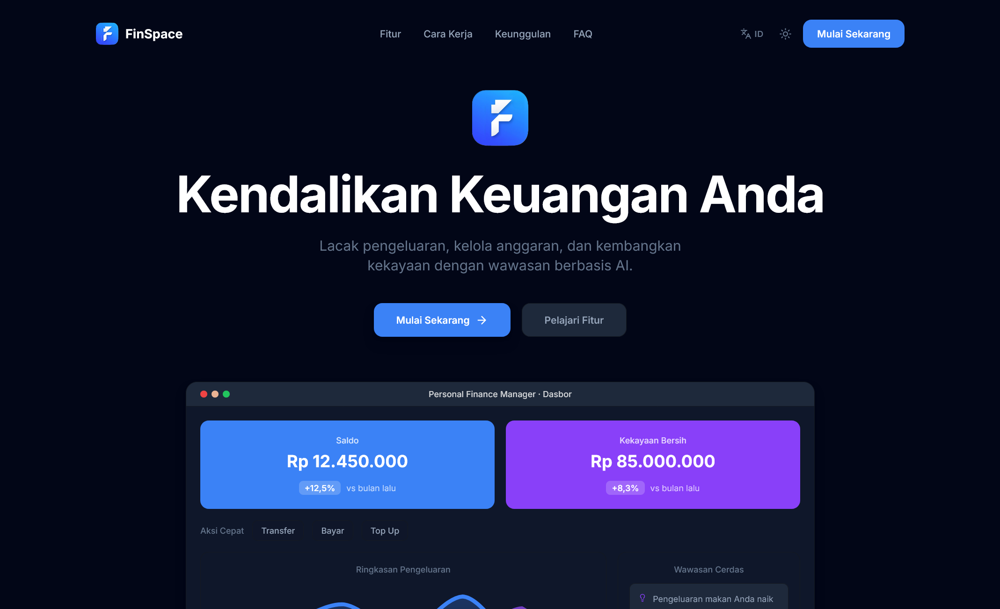

<p align="center">
  
</p>

<p align="center">
  <strong>FinSpace — Personal Finance Manager</strong><br />
  Aplikasi manajemen keuangan pribadi <strong>offline-first</strong> dengan AI chatbot, scan struk OCR, Web Bluetooth untuk cetak struk thermal, dan 6 tema warna aksen.
</p>

<p align="center">
  
  
  
  
  
  
  
</p>

---

## 🎯 Fitur Utama

### 📊 Dasbor
- Ringkasan kekayaan bersih real-time (aset − liabilitas − utang + saldo kantong)
- Grafik arus kas harian + tren bulanan (Recharts)
- Kartu pemasukan/pengeluaran bulanan dengan indikator MoM
- Riwayat transaksi terbaru dengan navigasi cepat
- Smart Insights: notifikasi pengeluaran berlebihan, tagihan jatuh tempo, rekomendasi tabungan

### 💰 Anggaran & Kantong
- Aturan 50/30/20 (Kebutuhan / Keinginan / Tabungan) — hitungan otomatis dari transaksi
- 6 preset kantong: Tunai, Dana, Gopay, BCA, Seabank, Bank Jago
- Saldo kantong dihitung: Σ pemasukan − Σ pengeluaran per kantong
- Transfer antar kantong (deducted from source, added to target)
- Filter transaksi per kantong, pencarian global, pagination

### 📈 Kekayaan (Net Worth)
- **Aset**: kas, investasi (emas, reksa dana, saham), properti, lain-lain
- **Liabilitas**: kartu kredit, paylater, cicilan
- **Utang**: hutang dengan jangka waktu, bunga, pelunasan parsial
- Rasio kesehatan keuangan: Likuiditas, Rasio Tabungan, Debt-to-Income
- Skor kesehatan gabungan (0–100) dengan status visual

### 🤖 Finny AI Assistant
- Chatbot finansial (Gemini via `@ai-sdk/google`)
- Scan struk OCR → ekstraksi merchant, nominal, kategori, tanggal
- Hybrid AI: antrian offline (`ai_queue` IndexedDB) + background sync saat online
- Riwayat percakapan persisten (Dexie Cloud)

### 🖨️ Cetak Struk Thermal (Web Bluetooth)
- Pilih perangkat Bluetooth printer thermal (ESC/POS)
- Template struk rapi: merchant, item, total, pembayaran, QRIS
- Bekerja offline total — tidak perlu server

### 🎨 6 Tema Warna Aksen
| Tema | Warna Utama | Cocok Untuk |
|------|-------------|-------------|
| Default | Biru–Ungu | Umum, profesional |
| Ember | Amber–Terakota | Hangat, personal |
| Aqua | Teal | Segar, modern |
| Nebula | Violet–Magenta | Kreatif, gelap |
| Bloom | Mawar | Lembut, estetis |
| Monokrom | Abu-abu | Minimalis, aksesibilitas |

Tema diterapkan via CSS custom properties — tanpa runtime overhead.

### 🌐 Offline-First & PWA
- Service Worker (Serwist) cache aset statis + navigation preload
- Background Sync antrian AI & sinkronisasi Dexie Cloud
- Installable di Android/iOS/desktop
- Mode gelap/terang otomatis (`prefers-color-scheme`) + toggle manual

---

## 🏗️ Arsitektur

```mermaid
flowchart TD
    A[User Interaction] --> B[React 19 Components]
    B --> C{Online?}
    C -- Yes --> D[Dexie Cloud Sync]
    C -- No --> E[Local IndexedDB]
    D --> F[(Dexie Cloud / Remote DB)]
    E --> G[(Local IndexedDB)]
    B --> H[useLiveQuery Hooks]
    H --> G
    B --> I[AI Queue (IndexedDB)]
    I -- SW Background Sync --> J[Gemini API]
    B --> K[Web Bluetooth]
    K --> L[Thermal Printer]
    B --> M[Service Worker Cache]
    M --> N[Static Assets / Offline Shell]
```

- **Data flow**: UI → hooks (`useTransactions`, `usePockets`, `useAssets`, dll.) → Dexie liveQuery → IndexedDB → Dexie Cloud (bg)
- **Offline queue**: `ai_queue` tabel → Service Worker `background sync` → API call
- **Auth**: Anonymous Dexie Cloud → upgrade ke Google OAuth kapan saja

---

## 🖼️ Tangkapan Layar

| Halaman | Pratinjau |
|---------|-----------|
| **Dasbor** (gelap, aksen Default) |  |
| **Anggaran** (gelap, ring 50/30/20 + kantong) |  |
| **Kekayaan** (gelap, aset/liabilitas/utang + rasio) |  |
| **Transaksi** (gelap, tabel desktop + filter) |  |
| **Pengaturan** (terang, aksen Ember — pemilih aksen) |  |
| **Landing** (gelap, hero + mockup fitur) |  |

---

## 🛠️ Tech Stack (Versi Terkini)

| Layer | Pilihan | Catatan |
|-------|---------|---------|
| **Framework** | Next.js 16.2.9 (App Router) + React 19.2.4 | Turbopack dev |
| **Styling** | Tailwind CSS v4 (`@import "tailwindcss"` + `@theme`) | Tanpa `tailwind.config.js` |
| **Database Lokal** | Dexie.js 4 + dexie-cloud-addon | IndexedDB + cloud sync |
| **State & Query** | `useLiveQuery` (dexie-react-hooks) + custom hooks | Reaktif, auto-refetch |
| **Ikon** | Lucide React | Tree-shakable imports |
| **Chart** | Recharts (lazy-loaded via `next/dynamic`) | Hanya di halaman yang butuh |
| **AI** | `@ai-sdk/google` (Gemini) + `ai` (Vercel AI SDK) | Streaming response |
| **OCR** | Tesseract.js (WASM) | Client-side scan struk |
| **PDF** | jsPDF + jspdf-autotable | Export laporan/cetak |
| **PWA** | Serwist (SW generator) | Workbox-based |
| **Bluetooth** | Web Bluetooth API (native) | ESC/POS thermal printer |
| **I18n** | Custom hook `useLanguage` (EN/ID) | JSON di `src/lib/i18n/` |
| **Testing** | Vitest + React Testing Library + JSDOM | 256 tests, 100% pass |
| **Lint/Format** | ESLint (flat config) + Prettier | Strict TS, no-unused-vars |
| **Hosting** | Vercel | Edge-ready |

---

## 🚀 Memulai

### Prasyarat
- Node.js ≥ 20
- npm ≥ 10
- (Opsional) Akun Dexie Cloud untuk sinkronisasi multi-device

### Instalasi

```bash
# Clone repository
git clone https://github.com/codenamezaxx/FinSpace.git
cd FinSpace

# Install dependencies
npm install

# Development server (Turbopack)
npm run dev
```

Buka **http://localhost:3000** — halaman landing tampil pertama kali. Klik "Mulai" untuk masuk ke aplikasi (local-first, tidak perlu login).

### Variabel Lingkungan (Opsional)

Buat `.env.local` untuk fitur cloud & AI:

```env
# Dexie Cloud (sync multi-device)
NEXT_PUBLIC_DEXIE_CLOUD_URL=https://your-instance.dexie.cloud

# Google Gemini API (Finny chatbot + scan struk)
GOOGLE_GENERATIVE_AI_API_KEY=your_gemini_key
```

Tanpa variabel ini: aplikasi tetap berfungsi penuh secara lokal (anonymous Dexie Cloud, AI dinonaktifkan).

### Build & Jalankan Production

```bash
npm run build    # Production build (Next.js standalone)
npm run start    # Jalankan server production
```

### Testing

```bash
npm test         # Vitest run (256 tests)
npm run test:watch  # Watch mode
npm run lint       # ESLint check
```

---

## 📁 Struktur Proyek (Aktual)

```
src/
├── app/                          # Next.js App Router
│   ├── (app)/                    # Route group: aplikasi utama (auth required)
│   │   ├── budget/               # /budget, /budget/pockets, /budget/transactions
│   │   ├── dashboard/            # /dashboard
│   │   ├── finny/                # /finny (AI chatbot)
│   │   ├── settings/             # /settings (profil, tema, aksen, notifikasi, sync)
│   │   ├── tools/                # /tools (kalkulator, perencana, export)
│   │   └── wealth/               # /wealth, /wealth/assets, /wealth/debts
│   ├── (landing)/                # / (landing page publik)
│   ├── ~offline/                 # Halaman offline fallback
│   ├── api/                      # API routes (jika ada)
│   ├── globals.css               # Tailwind v4 + @theme + CSS variables
│   └── layout.tsx                # Root layout + ThemeProvider + FOUC guard
├── components/
│   ├── ai/                       # FinnyChat, ReceiptScanner
│   ├── budget/                   # BudgetRing, PocketCard, TransferModal
│   ├── dashboard/                # MonthlyChart, SmartInsights, TransactionHistory
│   ├── layout/                   # BottomNav, Sidebar, Topbar, FAB
│   ├── notifications/            # Toast, NotificationBell
│   ├── settings/                 # AccentPicker, ThemeToggle, ProfileSection
│   ├── shared/                   # TransactionList, TransactionCard, Modals, Pagination
│   ├── tools/                    # LoanCalculator, SavingsGoal, ExportCSV, PrintReceipt
│   └── wealth/                   # AssetCard, LiabilityCard, DebtList, NetWorthCard
├── hooks/                        # 24 custom hooks
│   ├── useTransactions.ts        # LiveQuery transaksi + filter/sort
│   ├── usePockets.ts             # Kantong + saldo terhitung
│   ├── useAssets.ts / useLiabilities.ts / useDebts.ts
│   ├── useNetWorth.ts            # Kalkulasi kekayaan bersih + rasio
│   ├── useFinancialRatios.ts     # Likuiditas, Tabungan, DTI
│   ├── useTheme.ts / useAccent.ts / useColorScheme.ts
│   ├── useCloudAuth.ts           # Dexie Cloud auth state
│   ├── useDebounce.ts / usePagination.ts / useLocalStorage.ts
│   └── ... (13 hooks lainnya)
├── lib/
│   ├── db.ts                     # FinSpaceDB (Dexie + Cloud addon, v7 schema)
│   ├── ids.ts                    # Prefix ID: trn_, ass, lbl, dbt, ntf, aq_, pck, fnn_, Fnnu_, Fnna_, app
│   ├── pocket.ts                 # Pocket type + PRESET_POCKETS (6)
│   ├── constants.ts              # Kategori 3-bucket, payment methods, merchants
│   ├── netWorth.ts               # calculateNetWorth, formatCurrency, types
│   ├── financialRatios.ts        # calculateAllRatios, calculateHealthScore
│   ├── debtUtils.ts              # totalMonthlyDebtObligation, amortization
│   ├── accents.ts                # 6 tema aksen + parser + CSS tokens
│   ├── theme-context.tsx         # ThemeProvider (dark/light + accent)
│   ├── i18n/translations.ts      # EN/ID dictionary (400+ keys)
│   ├── seed.ts                   # seedDatabase (unused di UI, untuk referensi)
│   ├── transaction-modal-context.tsx
│   ├── asset-liability-modal-context.tsx
│   ├── printReceipt.ts / receiptPdf.ts / monthlyReportPdf.ts
│   ├── bluetooth.ts              # Web Bluetooth ESC/POS driver
│   ├── reminders.ts              # Notification scheduling
│   └── insights.json             # Static insight templates
├── styles/                       # (kosong — pakai globals.css)
└── middleware.ts                 # (jika ada)
```

---

## ⚙️ Skrip Tersedia

| Perintah | Kegunaan |
|----------|----------|
| `npm run dev` | Development server (Turbopack, localhost:3000) |
| `npm run build` | Production build (standalone output) |
| `npm run start` | Jalankan production server |
| `npm run lint` | ESLint (flat config, strict) |
| `npm test` | Unit test Vitest (256 test, ~3 detik) |
| `npm run test:watch` | Watch mode test |

---

## 🔑 Detail Teknis Penting

### Skema Database (Dexie v7 + Cloud)

| Tabel | Primary Key (prefix) | Deskripsi |
|-------|----------------------|-----------|
| `transactions` | `trn_` | Pemasukan/pengeluaran, kategori 3-bucket, pocketId |
| `pockets` | `pck…zed` (auto) | 6 preset + custom, kategori tunai/ewallet/rekening |
| `assets` | `ass` | Kas, investasi, properti, lain-lain |
| `liabilities` | `lbl` | Kartu kredit, paylater, cicilan |
| `debts` | `dbt` | Hutang dengan jatuh tempo, bunga, pelunasan |
| `notifications` | `ntf` | Pengingat, overspending, credit reminder |
| `ai_queue` | `aq_` | Antrian chatbot/scan offline → background sync |
| `finny_sessions` | `fnn_` | Riwayat percakapan AI |
| `finny_messages` | `Fnnu_` / `Fnna_` | Pesan user/assistant per session |
| `app_meta` | `app` | Flag migrasi, marker preset terhapus |

> **Penting**: Dexie Cloud menolak key tanpa prefix yang sesuai (`@id` di schema). Semua insert **harus** pakai prefix di atas.

### Kategori Transaksi (3-Bucket System)

```
Kebutuhan  → Needs (50%)   — Makanan, transport, tagihan, kesehatan
Keinginan  → Wants (30%)  — Hiburan, belanja, kopi, streaming
Tabungan   → Savings (20%) — Gaji, investasi, emas, reksa dana
```

Kategori lama (Makanan & Minuman, Transportasi, dll.) tetap didukung via mapping di `budgetRules`.

### ID Prefix Generator (`src/lib/ids.ts`)

```ts
generateId('trn')   // → "trn_<timestamp>_<random>"
generateId('ass')   // → "ass<random>"
generateId('pck')   // → "pck<random>zed"  (auto-generated preset)
```

Gunakan `generateId(prefix)` untuk insert manual agar lolos ConstraintError Dexie Cloud.

### Performa (Wajib Dijaga)

- **Lazy load**: Recharts, PDF, Tesseract via `next/dynamic(..., {ssr:false})`
- **Tree-shaking**: Import spesifik (`import { Plus } from "lucide-react"`)
- **IndexedDB**: Query selektif (`where().equals()`), bulk operations, `useLiveQuery` filter di query bukan komponen
- **Animasi**: CSS-only (`transition`, `transform`, `opacity`), `will-change` minimal
- **Bundle**: Vendor chunks auto-split, target route < 200 KB gzip

---

## 🤝 Kontribusi

Proyek ini privat. Jika Anda tim internal:

1. Buat branch fitur: `git checkout -b feat/nama-fitur`
2. Pastikan `npm run lint && npm test` hijau
3. Commit message konvensional: `feat(scope): deskripsi singkat`
4. Push dan buka PR ke `main`

---

## 📄 Lisensi

**Proyek privat** — tidak untuk distribusi publik. Hak cipta © 2024–2026 codenamezaxx.